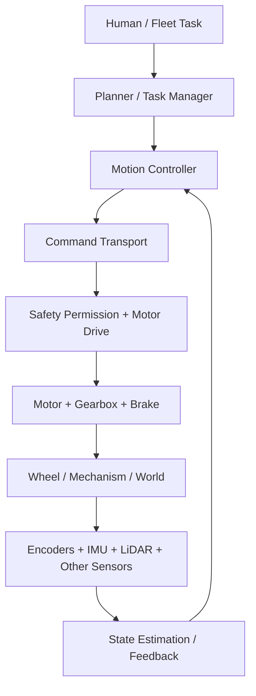
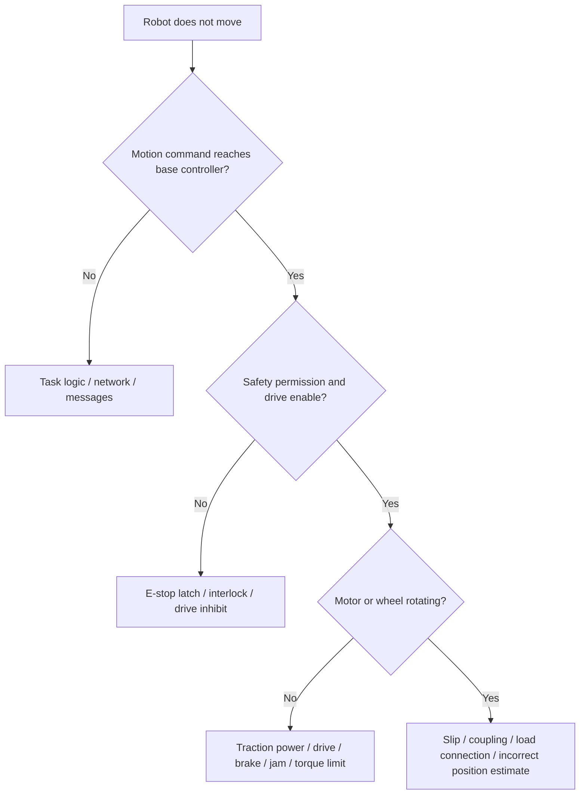
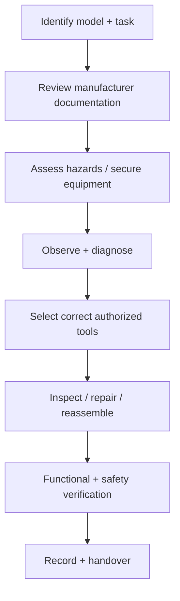

# Module 1: Thinking Like a Field Troubleshooter

> **Core idea:** Find the first point where **expected behavior** differs from **observed behavior**. Diagnose before replacing parts.
>
> These are general robotics study notes, not a substitute for equipment-specific service procedures.

## 1. The complete robot is a chain of subsystems



Each arrow is an interface that might fail. The planner can be running while the drive is inhibited. A drive may accept a command but lack usable power. A motor may turn while the vehicle stays still because the wheel slips.

**Never equate these different observations:**

```text
Command generated ≠ Command received ≠ Drive enabled
                  ≠ Motor rotating ≠ Actual robot displacement
```

## 2. SCOPE: the five-stage diagnostic approach

| Stage | Meaning | Practical action |
|---|---|---|
| **S: Secure** | Make the situation safe | Protect people, equipment, and loads; prevent unintended motion; follow authorized isolation procedures. |
| **C: Characterize** | Establish the actual symptom | What should happen? What happens instead? When and under what conditions? |
| **O: Organize** | Divide the system into testable blocks | Safety, command path, power, motor drive, mechanics, sensor feedback, network. |
| **P: Probe** | Test competing hypotheses | Choose an approved check that distinguishes one explanation from another. |
| **E: Evaluate** | Interpret, correct, verify, document | Verify the repair and safety functions before returning equipment to service. |


**SCOPE is an opening structure, not a substitute for diagnosis.** After naming it, immediately identify two specific hypotheses and a measurement that distinguishes them.

### Three high-information opening questions

1. **What exactly fails?** No boot, no motion, motion error, loaded stall, docking fault, offline telemetry?
2. **What changed?** Payload, location, maintenance, configuration, software, temperature, or power conditions?
3. **What still works?** Display, safety state, command stream, drive enable, encoder counts, wheel motion?

## 3. Motion-failure fault tree



Follow observed evidence, not a rigid top-to-bottom ritual. If the safety controller reports an active protective stop, examine that condition before attempting movement. If failure occurs only while loaded, prioritize traction, force demand, current limits, and physical load constraints.

## 4. How to distinguish hypotheses

| Observation | Hypothesis A | Hypothesis B | Best next evidence |
|---|---|---|---|
| Dashboard says **READY**, robot stationary | Motion inhibited by safety state | Drive command/power absent | Safety and drive-enable status; command received/accepted |
| Drive enabled, high current, no wheel motion | Brake or mechanical jam | Excess load / insufficient torque | Drive fault history, actual wheel speed, authorized mechanical inspection |
| Wheels spin, robot doesn't translate | Tire-floor slip | Coupling/load issue | Independent vehicle-motion observation, wheel contact and coupling |
| Works after a restart | Reset state/service issue | Heat / intermittent power issue | Preserve logs, compare time-to-failure and fault history |
| Commanded speed looks correct | Command reaches software | Motor really follows it | Drive acceptance, encoder reading, independent physical motion |

### The complete diagnostic sentence

> “I observe **[symptom]**. My leading hypotheses are **[H1]** and **[H2]**. I would inspect **[specific evidence]**: if I see **[result A]**, I would investigate **[H1]**; otherwise, **[H2]**. After an approved correction, I would repeat functional and safety checks.”

## 5. Working with unfamiliar equipment



**Avoid automatically plugging a personal laptop into an unknown machine.** Identify the model, authorized diagnostic interface, access requirements, and safety implications first. A diagnostic connection can change operating state or introduce cybersecurity and compatibility risks.

**Basic tool knowledge:** On a standard right-hand threaded screw, clockwise tightens and counterclockwise loosens *when viewed from the screw head*. Left-hand threads are exceptions. Select the correct tool/bit, identify what the fastener retains, and use the manufacturer's tightening torque where required.

## 6. Safety rules that change your diagnosis

- **Emergency stop is not equivalent to electrical energy isolation.** Stored electrical, mechanical, spring, rotational, and gravitational energy may remain.
- Never bypass safety interlocks or increase torque/current limits as an improvised fix.
- Use lockout/tagout and energized-work procedures only within training, authorization, and site rules.
- If a rack or load is involved, secure it against rolling, tipping, and unexpected movement.
- A reboot, fault reset, or successful single run does not establish the root cause or justify unrestricted return to service.

## 7. Worked example: robot powered on, but stationary

**Observed:** Dashboard is on, operator requests forward motion, robot remains stationary.

1. Secure robot and people; inspect safety state and alarms.
2. Check whether the movement request exists and reaches the motion controller.
3. Check whether the drive is enabled, fault-free, and accepting commands.
4. If inhibited, diagnose safety permissions. If enabled but nonresponsive, check traction-power and approved drive diagnostics.
5. If wheels turn but the vehicle doesn't, investigate traction, coupling, and independent motion feedback.
6. Correct the demonstrated cause, retest at approved low speed and representative conditions, document results.

## Notebook summary

```text
SCOPE = Secure → Characterize → Organize → Probe → Evaluate
Expected ≠ Observed → Find first broken subsystem boundary
Two hypotheses + one discriminating test > one confident guess
Command ≠ Drive Enabled ≠ Wheel Rotation ≠ Vehicle Motion
```

### Self-check

- Can you name two causes of “READY but not moving” and one test that distinguishes them?
- Why does a successful reboot not prove repair?
- What checks are needed before returning a machine to service?

[← README](README.md) · [Next: Mechanical Systems →](02-Mechanical-Systems.md)

---