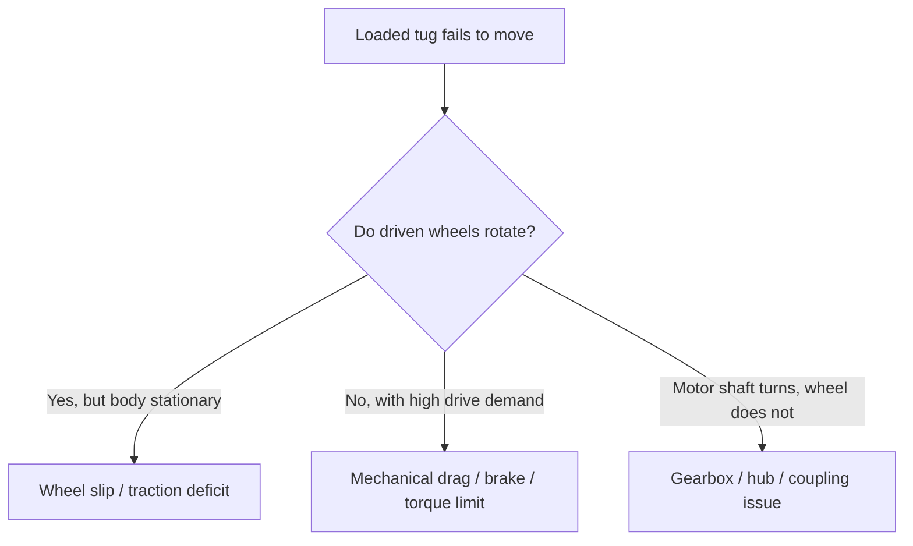
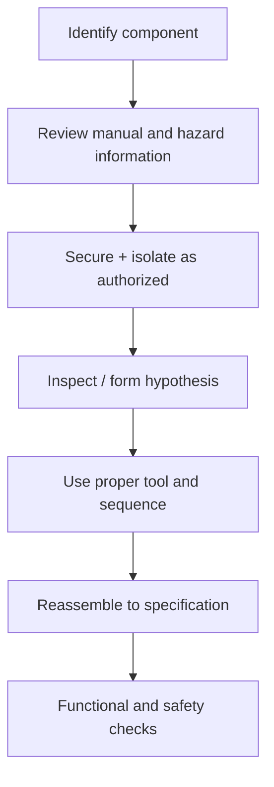

# Module 2: Mechanical Intuition, Drivetrains, and Robotic Tugs

> **Core idea:** Motion requires adequate **torque, mechanical transmission, traction, and permissible load**. A motor spinning is not the same as useful movement.
>
> The tug-and-rack examples are generic learning scenarios, not specifications for a particular manufacturer.

## 1. Mechanical motion chain


When diagnosing motion failures, ask **which link is not producing its expected effect**. A motor can be energized without rotating; a motor shaft can rotate while a coupling fails; a wheel can rotate while slipping; a tug can move while its load remains unsecured.

## 2. Minimum mechanics to remember

| Relationship | Physical meaning | Diagnostic significance |
|---|---|---|
| $\tau = Fr$ | Wheel torque $\tau$ equals tangential force $F$ times wheel radius $r$ | Larger force demand requires larger wheel torque. |
| $F \approx ma + C_{rr}mg$ | Simplified level-ground force includes acceleration and rolling resistance | Heavier load or damaged casters raise force demand. |
| $F_{hill} = mg\sin\alpha$ | Gravity adds uphill resistance | Ramps are harder than level floors. |
| $F_{traction,max} \approx \mu N_{driven}$ | Friction coefficient $mu$ and normal load $N$ cap traction | A wheel can spin without moving the vehicle. |
| $P = Fv$ | Mechanical power at speed $v$ | Faster loaded movement demands more power. |

All formulas are simplified engineering models. Real machines include gear efficiency, tug mass, loading geometry, dynamics, and manufacturer limits.

**Important subtlety:** A heavier rack does **not** automatically increase the normal force on the tug's driven wheels. Much of its weight may be supported by rack casters. Coupling geometry determines any load transfer.

### Traction versus stall



- **Wheel slip:** available tire-floor friction is less than the commanded tractive force.
- **Stall:** actuator cannot rotate under present opposing load, perhaps because of an obstruction, engaged brake, friction, or insufficient torque.
- **Loose coupling:** some rotating component moves, but downstream mechanical output is not transmitted properly.

## 3. Worked numerical intuition

**Illustrative example:** A 400 kg rack on level ground, rolling-resistance coefficient $C_{rr}=0.02$, acceleration $a=0.2\;\mathrm{m/s^2}$, and wheel radius $r=0.10\;\mathrm{m}$. Ignoring tug mass and other losses:

$$
F_{rr} = 0.02(400)(9.81) \approx 78.5\;\mathrm{N}
$$

$$
F_a = 400(0.2) = 80\;\mathrm{N}
$$

$$
F_{total} \approx 158.5\;\mathrm{N},\qquad
\tau \approx Fr = 15.9\;\mathrm{N\cdot m}
$$

This is **not** a motor selection calculation or actual tug rating. It shows why load, acceleration, slope, and rolling resistance matter.

## 4. Diagnostic scenarios

| Symptom | Leading causes | High-information observation |
|---|---|---|
| Works unloaded, fails loaded | Load beyond approved envelope, dragging rack caster, power/current limit, traction limit | Compare unloaded/loaded drive status, wheel motion, caster condition, voltage/current under authorized tests |
| Wheels visibly spin, rack stationary | Wheel slip from poor grip, poor load transfer, worn tires | Tire-floor contact and independent displacement |
| Leftward veer on straight command | Unequal left/right wheel speeds, encoder scaling, tire diameter, friction, bearing drag, alignment | Compare command and actual speeds on both sides, wheel geometry, independent heading |
| Problem only when turning | Locked/swivel-resistant caster, hitch geometry, swept-path obstruction, unequal traction | Observe caster behavior and turn geometry safely |
| Heating and noise near a wheel | Bearing damage, brake drag, gearbox wear, loose mount | Current/temperature trends and authorized mechanical inspection |
| Stops at threshold or ramp | Clearance, slope, caster jam, traction, current limit, protective stop | Floor geometry, drive faults, contact points, safety status |
| Tow load separates or rolls away | Hitch/retention failure | **Stop immediately, secure load, escalate** |

### Example: robot veers left

Two useful competing hypotheses:

1. **Mechanical asymmetry:** Left wheel has more drag or different effective radius; tire wear or alignment differs.
2. **Control/feedback asymmetry:** Left and right motor commands, encoder scaling, or measured speeds are inconsistent.

**Discriminating check:** In an approved low-speed, clear-area test, compare commanded left/right wheel speeds, measured speeds, and actual heading. This is more informative than immediately adjusting controller gains or replacing a wheel.

## 5. Mechanical components in plain English

- **Motor:** Creates rotational torque from electrical energy.
- **Gearbox:** Exchanges rotational speed for torque, accounting for losses.
- **Bearing:** Supports rotation while reducing friction; failure can produce noise, heat, vibration, and higher load.
- **Brake:** Resists or holds motion; a brake that remains applied may cause stalls and heating.
- **Coupler/shaft/hub:** Transmits torque between rotating components.
- **Caster:** A passive support wheel that may need to swivel; damaged or locked casters resist towing.
- **Hitch/tow coupling:** Connects tug to load; geometry and retention affect safety and movement.
- **Center of gravity:** Influences stability; tall loads are vulnerable to overturning during turns or over uneven floors.

## 6. Familiar mechanical tools and unfamiliar assemblies

A question such as “Have you dismantled a car?” tests curiosity and physical familiarity. **Do not invent automotive service work.** Knowing a vehicle's engine, transmission, differential, brakes, suspension, and drivetrain is different from having repaired them.

For an unfamiliar robot assembly:



Standard right-hand screw: **clockwise = tighten; counterclockwise = loosen**, viewed from the head. Exceptions exist. Use properly fitting drivers/sockets (slotted, Phillips, Torx, hex/Allen), avoid stripping fasteners, and do not loosen load-bearing or spring-retaining parts without knowing their function.

## Notebook summary

```text
Motor → Gearbox → Wheel → Ground → Load
τ = F r                 F_traction,max ≈ μN
Wheel spins + no motion → traction/slip
Wheel stationary + high current → stall/drag/brake/limit
Motor shaft spins + wheel stationary → coupling/gearbox
```

### Self-check

- Why can a tug work unloaded but stall under a rack load?
- How would you distinguish wheel slip from a seized bearing?
- Why is a loaded turn potentially more hazardous than straight travel?

[← Previous: Field Troubleshooting](01-Field-Troubleshooting.md) · [Next: Electrical Systems →](03-Electrical-Systems.md)

---