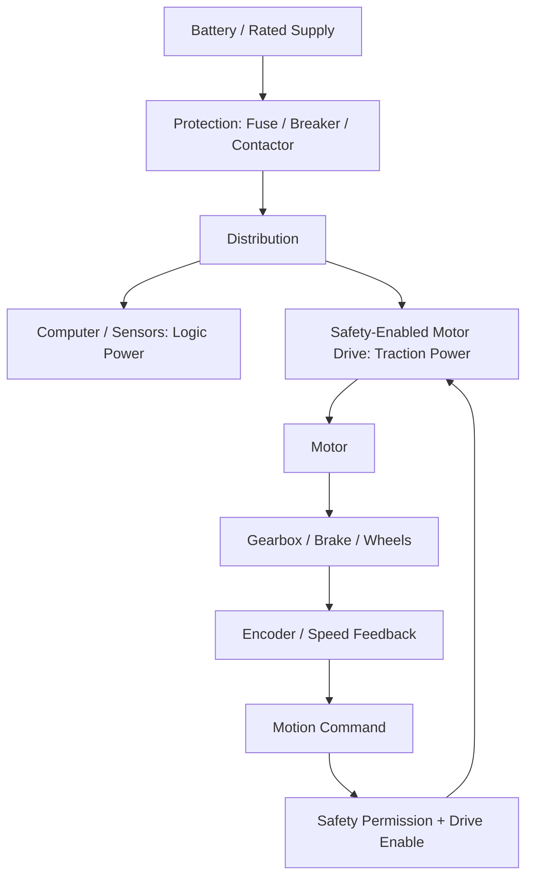
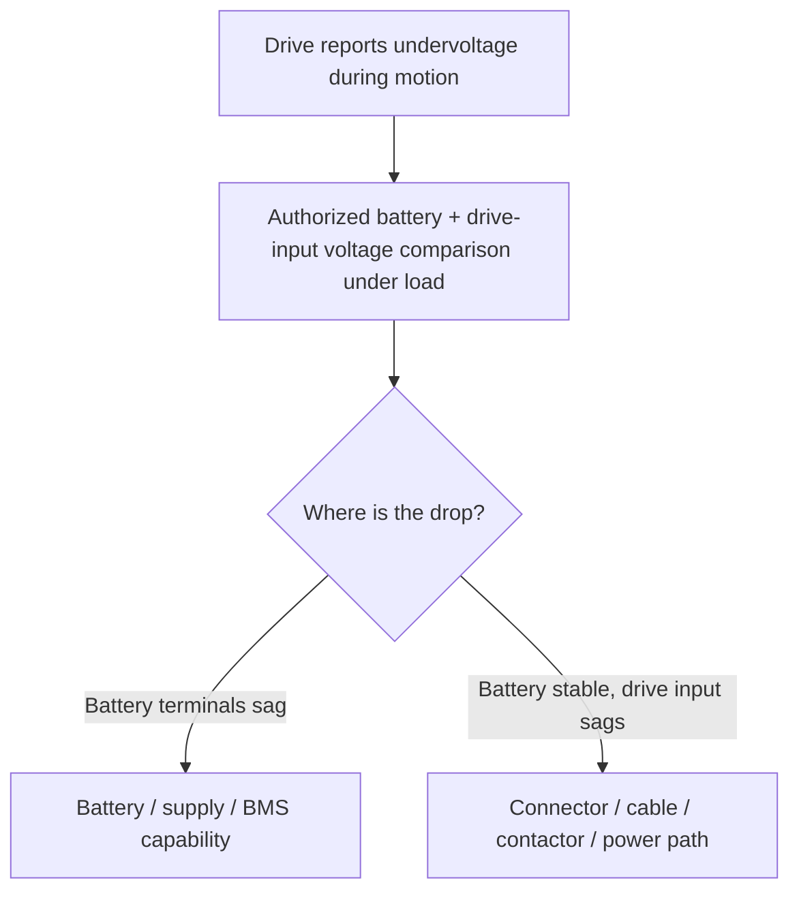
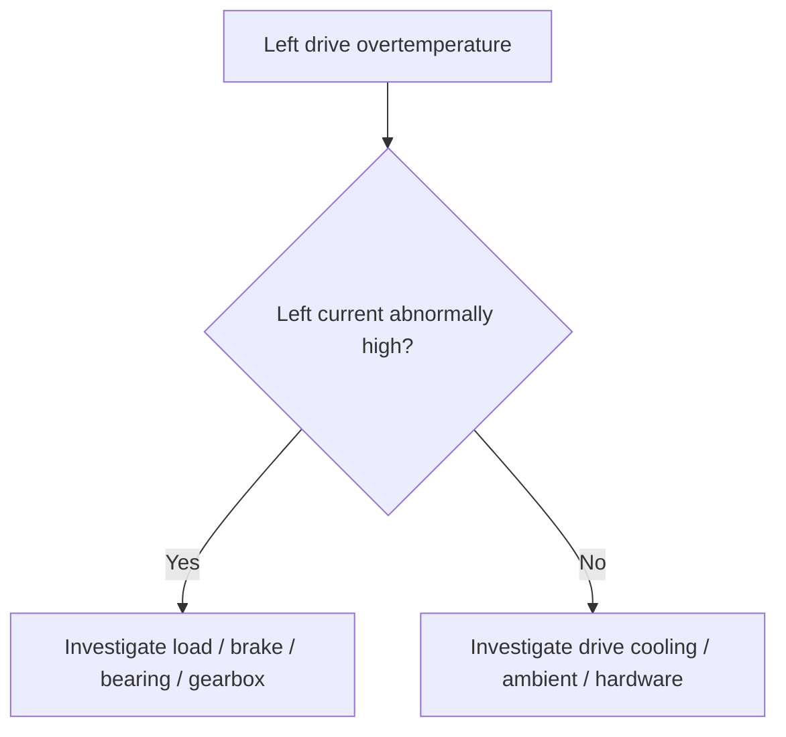
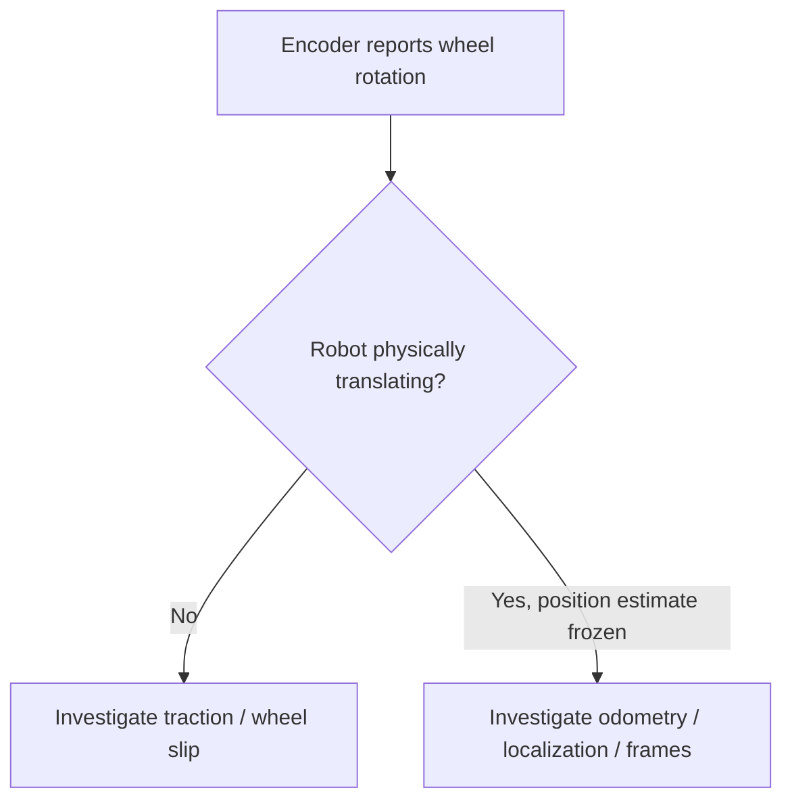

# Module 3: Electrical Hardware, Motor Drives, and Feedback

> **Core idea:** A controller that is powered on does **not** prove the traction system is energized. A motor-drive fault code reports a condition, not necessarily the defective component.
>
> All voltage levels and hardware layouts shown below are illustrative; real robot architectures must be confirmed in manufacturer documentation.

## 1. Power and control are separate paths



Many robots separate low-power electronics from high-power actuation. The screen and sensors may function even while the traction branch is isolated, a contactor is open, or the drive lacks safety permission.

**Do not infer traction readiness from a green dashboard or an E-stop button merely being released.**

```text
Logic powered ≠ Traction powered
E-stop released ≠ Safety reset ≠ Drive enabled
Command issued ≠ Current/torque produced ≠ Actual motion
```

## 2. Electrical formulas with physical meaning

| Formula | Meaning | Example use |
|---|---|---|
| $V=IR$ | Ohm's law | High current through resistance produces a voltage drop. |
| $P=VI$ | Electrical power | A 24 V, 5 A load consumes about 120 W. |
| $\Delta V=I R_{path}$ | Simplified resistive voltage drop | A weak power connection can become a problem under motor load. |
| $P_{loss}=I^2R$ | Resistive heating | Large current may heat a poor contact, cable, or power element. |
| $\tau \propto I$ | Approximate motor torque/current relationship | Mechanical load often raises current demand, subject to drive limits. |

**Illustration:** A 0.15 Ω path resistance at 20 A causes a 3 V drop and dissipates about 60 W as heat. This explains why an electrical branch may look healthy at rest and fail when the motors start.

### Undervoltage despite a high battery percentage



State of charge is not the same as instantaneous voltage available to a high-current load. An 80% battery indicator does not rule out battery voltage sag or a resistive connection.

## 3. Know the key components

| Component | Role | Fault pattern or check |
|---|---|---|
| Battery/BMS | Provides and supervises energy | Voltage sag, current limit, BMS fault history |
| Fuse/breaker | Protects against overcurrent | Open/tripped branch; **never bypass or oversize** |
| Contactor | Switches a high-power branch | Controller on, traction off; inspect command and contactor feedback |
| DC-DC converter | Creates auxiliary supply rails | Sensor/compute reset, rail problems |
| Safety controller/interlocks | Permit or inhibit hazardous motion | Safety status, protective-stop reason, approved reset state |
| Motor driver | Controls motor power, current/torque, protection | Received command, enable state, current, fault codes, temperature |
| Electric motor | Converts electrical energy to mechanical torque | Stall, heat, abnormal current, lack of rotation |
| Gearbox/coupling | Transfers and modifies torque | Motor rotates but downstream output doesn't |
| Brake | Holds or resists motion | Engaged brake can cause stall and heat |
| Encoder/Hall feedback | Measures shaft motion or supports commutation | Missing counts, wrong direction, scaling, noisy signal |

**Actuator:** a component that converts supplied energy and a control command into physical force or motion. An electric motor is an actuator; a motor driver is typically its power-electronics interface.

## 4. Motor-drive fault codes are evidence, not diagnoses

### Case A: overtemperature after 20 minutes

**Two competing hypotheses:**

1. **Mechanical resistance:** A dragging brake, worn bearing, damaged gearbox, or excess load increases required torque/current, heating the motor/drive.
2. **Drive/cooling issue:** Poor airflow, high ambient temperature, or drive hardware problems cause overheating even without unusually high current.

**Discriminating evidence:** Compare left versus right **current, drive temperature, time-to-failure, load and cooling conditions**. A left-side-only fault helps localize the problem but does not prove the left drive itself is broken.



### Case B: overcurrent

The drive may correctly shut down to protect itself from an electrical short, high mechanical load, stalled motor, or other problem. Do not immediately replace the drive or raise current limits. Correlate fault time with commanded motion, load, motor speed, and safe diagnostics.

### Case C: intermittent failure cleared by reboot

Resetting may clear a fault latch or temporarily restore a software state, but it can also hide the evidence. Preserve logs and correlate failure with temperature, duty cycle, voltage, and elapsed operating time.

## 5. Encoders: what they measure and what they don't

An incremental encoder commonly produces pulses as its shaft rotates. A quadrature encoder uses phase-shifted A/B signals to infer direction.

$$
\Delta\theta=\frac{2\pi\,\Delta N}{N_{counts/rev}}
$$

Here $N_{counts/rev}$ must match the encoder's **actual counting convention** and whether measurements refer to the motor shaft or wheel shaft.



**Crucial distinction:** Encoder counts can be accurate while a tire spins in place. The robot's estimated pose can also be wrong even though it moves correctly.

## 6. PWM and feedback control essentials

- **PWM (pulse-width modulation):** Power electronics switch to produce a controllable effective motor drive. Duty cycle is a command mechanism, not proof of torque or motion.
- **Open-loop control:** Produces outputs without correcting measured response.
- **Closed-loop control:** Compares desired behavior to measured feedback and corrects the error.
- **PID:** Proportional action responds to current error; integral action accumulates error; derivative action responds to change in error.
- **Saturation:** Physical and electrical limits cap what a controller can demand.
- **Integral windup:** The I term can accumulate while the actuator saturates, harming recovery; anti-windup addresses this in controller design.

$$
e(t)=r(t)-y(t)
$$

$$
u(t)=K_pe(t)+K_i\int_0^t e(\tau)\,d\tau+K_d\frac{de(t)}{dt}
$$

**Best engineering habit:** Before retuning a controller, inspect feedback quality, sign conventions, actuator enable/limits, and mechanics. Controller tuning cannot fix a seized bearing or unpowered drive.

## 7. Five fault patterns

| Symptom | Consider first | Evidence that matters |
|---|---|---|
| Stops as motors start | Voltage sag, excessive starting current, bad connector, BMS limit | Voltage at battery vs drive under authorized load; faults |
| Stops after prolonged use | Thermal shutdown, mechanical drag, cooling, degrading connection | Current, temperature, fault history, operating duration |
| Battery voltage okay but drive disabled | Contactor, fuse, interlock, drive enable | Branch power and safety/enable status |
| Moves in opposite direction | Sign/encoder/config mapping | Command sign vs measured wheel/world direction, approved low-speed test |
| Fuse repeatedly opens | Short, overload, wiring abrasion, stalled load | Qualified electrical investigation; don't repeatedly reset or fit larger fuse |

## 8. Safety boundaries

- **E-stop is not lockout/tagout or proof of zero energy.** Batteries, capacitors, springs, elevated loads, and inertia can remain hazardous.
- Don't casually probe live high-energy circuits. For elevated electrical risks, request measurements from qualified, authorized personnel.
- Do not bypass a fuse, contactor, safety device, or interlock to “see if it works.”
- A failed safety function requires approved correction and retesting, not just an error-code reset.

## Notebook summary

```text
Battery → Protection/Contactor → Motor Drive → Motor → Gearbox/Wheel
                      ↑ Safety Permission + Enable
ΔV = I R           P = V I           Heating = I²R
Fault code = observed condition, NOT guaranteed defective component
Encoder measures rotation, NOT guaranteed ground displacement
```

### Self-check

- Why can the robot computer boot while the wheels cannot move?
- How do you distinguish battery sag from a bad power-path connection?
- What data separates mechanical drag from a drive cooling problem?

[← Previous: Mechanical Systems](02-Mechanical-Systems.md) · [Next: Linux, ROS 2, and Sensors →](04-Linux-ROS2-Sensors.md)

---