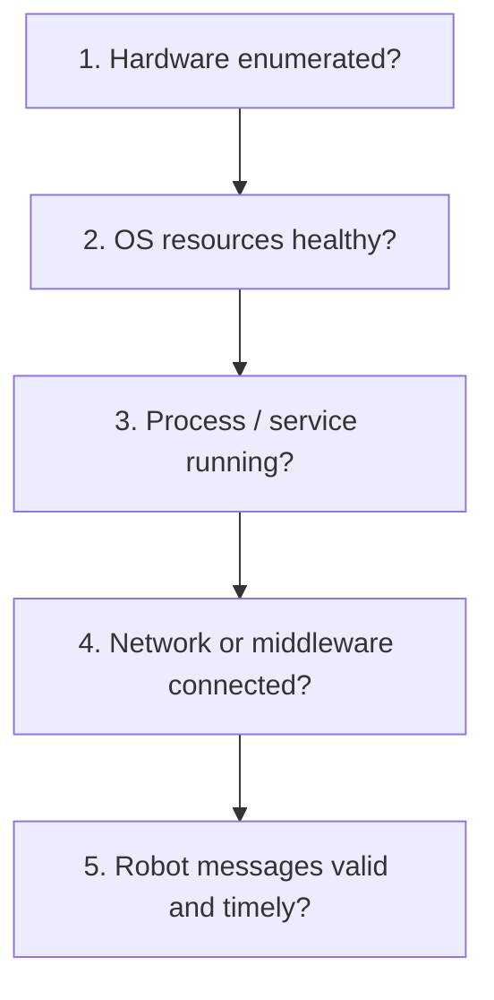
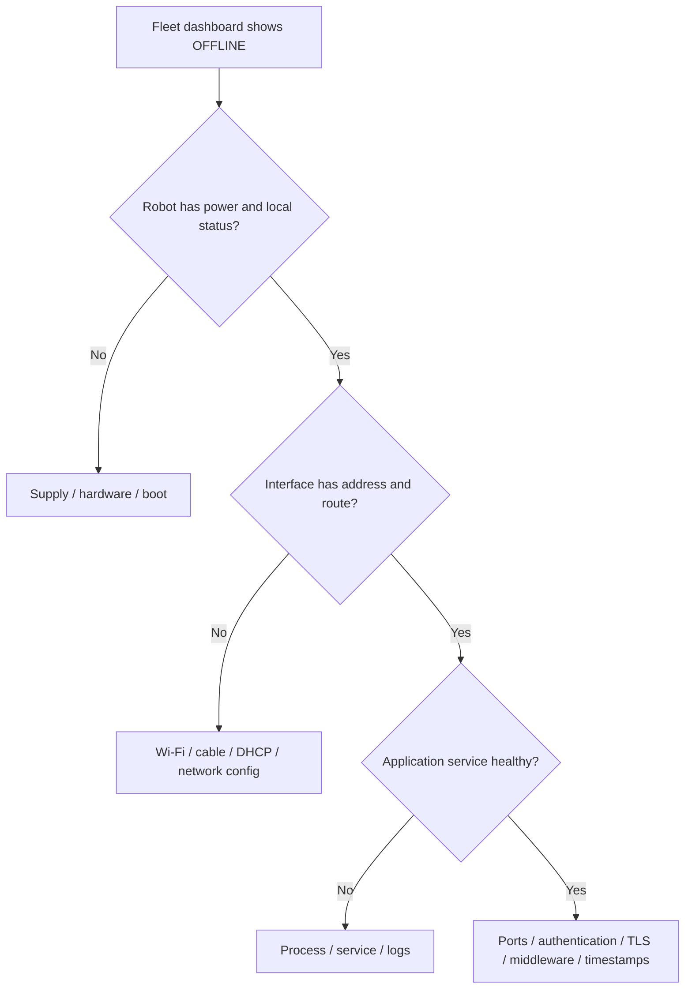
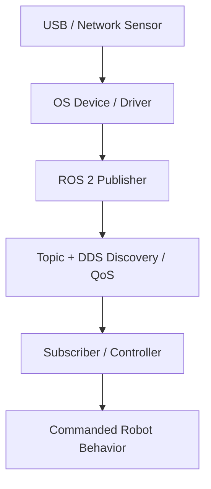
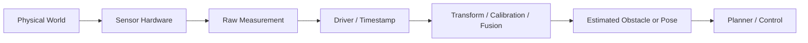

# Module 4: Linux, Networking, ROS 2, and Sensor Diagnostics

> **Core idea:** Diagnose from the physical interface upward: **device → OS → process → network/middleware → data → robot behavior**.
>
> ROS topic names here are conventional examples, not universal production-system interfaces.

## 1. The five levels of a Linux investigation



Don't run commands randomly. **First state the diagnostic question**, then choose a command that provides relevant evidence. Read-only inspection is usually lower risk than restarting services, changing network configuration, or clearing faults.

## 2. Linux command-to-evidence reference

| Diagnostic question | Command | What it tells you / what it does not |
|---|---|---|
| Where am I? What files exist? | `pwd`, `ls -lah`, `cd` | Directories and file visibility; does not prove application health. |
| Is the process alive? | `ps aux` | Process existence; not necessarily correct operation. |
| Is a managed service healthy? | `systemctl status SERVICE` | Running, failed, activating, restarting status. |
| What did the service report? | `journalctl -u SERVICE -n 100` | Recent service logs and failure clues. |
| What did the kernel report? | `dmesg | tail -n 50` | Device errors, disconnects, driver/kernel events; permission may be required. |
| Is the USB device enumerated? | `lsusb` | USB detection, not proof of functional sensor output. |
| Are resources constrained? | `top`, `free -h`, `df -h` | CPU/memory/disk pressure. |
| What addresses exist? | `ip addr` | IP/interface state; not application connectivity. |
| How is traffic routed? | `ip route` | Routing table/default gateway. |
| Is an allowed remote host reachable by ICMP? | `ping -c 4 HOST` | ICMP connectivity only; ICMP may be blocked. |
| Are ports/sockets present? | `ss -tulpen` | Listening sockets and permitted process associations; add other `ss` flags to inspect established connections. |
| What is in an application log? | `tail -n 100 FILE`, `grep -ni 'error' FILE` | Recent events / matched words; inspect surrounding context too. |

**Mnemonic:** `ctl` means **control** in `systemctl` (system/service control) and `journalctl` (querying the system journal).

## 3. “Offline” does not describe a single fault



| Observation | Correct interpretation |
|---|---|
| Ethernet link up | Physical/network link exists; no guarantee of working IP route. |
| Valid IP address | Local addressing exists; remote endpoint may still be unreachable. |
| Ping succeeds | ICMP path responds; fleet app, ports, and authentication may still fail. |
| Service runs | Process exists; may not be successfully connected/authenticated. |
| Dashboard online | Presence may be healthy while sensor telemetry or task delivery is stale. |

### Worked example: Wi-Fi works, fleet manager says offline

**Competing hypotheses:** (1) fleet client service failed; (2) service runs but authentication, required port, or application communication failed.

**Checks:** `systemctl status` and `journalctl` for service health/errors, `ss` for listening/established connections, and configuration/time/certificate diagnostics as authorized. Compare with a known-good robot on the same network.

## 4. ROS 2 interfaces: where data can disappear



| ROS 2 command | Diagnostic question |
|---|---|
| `ros2 node list` | Are expected nodes discoverable? |
| `ros2 topic list` | Are expected topics discoverable? |
| `ros2 topic info /scan` | What type/publishers/subscribers are visible? |
| `ros2 topic echo /scan` | Do scan messages actually arrive? |
| `ros2 topic hz /scan` | What is the approximate message frequency? |
| `ros2 topic echo /cmd_vel` | Are motion commands being published and sensible? |
| `ros2 topic echo /odom` | Does odometry look plausible? |
| `ros2 param list /NODE` | Which parameters are exposed? |
| `ros2 param get /NODE PARAM` | What is a specific parameter's value? |
| `ros2 service list` | Which services are discoverable? |
| `ros2 run tf2_ros tf2_echo odom base_link` | Is a specific frame transform being published? |

**Common traps:**

- A `/cmd_vel` topic may exist while the drive remains disabled or no downstream controller subscribes.
- A missing `/scan` topic may reflect USB/driver failure, node crash, namespace, ROS domain, DDS discovery, or QoS mismatch. It does **not** prove the LiDAR is broken.
- A topic that exists can still carry stale, incorrectly timestamped, wrongly framed, or nonsensical measurements.

### Worked example: USB LiDAR has no ROS 2 data

1. Check USB enumeration (`lsusb`) and device/kernel messages (`dmesg`).
2. Inspect the LiDAR driver node/process and associated logs.
3. Check expected topic name/namespace (`ros2 topic list`).
4. Inspect message content and rate (`ros2 topic echo`, `ros2 topic hz`).
5. If messages exist but perception fails, check timestamps, transforms, calibration, and interpretation.

**Difference:** `lsusb` answers whether Linux sees a USB device; `ros2 topic echo` answers whether usable messages are arriving through the middleware.

## 5. Sensors: measurement is not interpretation



| Sensor | What to compare | Typical problems |
|---|---|---|
| LiDAR | Raw range, scan frequency, actual geometry | Dirt, reflections, wrong mount/TF, dropouts |
| IMU | Rest acceleration, yaw rate, orientation | Bias, vibration, axis convention, timing |
| Wheel encoder | Counts, speed, sign vs real motion | Wiring, missed counts, scaling, wheel slip |
| Camera / depth | Frames, exposure, timestamp, depth | Lens, lighting, cable, calibration |
| Bumper/safety scanner | Safety state versus actual protective field | Trigger, latch, hardware/config fault |
| Docking/charging feedback | Physical contact vs reported state | Misalignment, dirt, worn connector |

**False obstacle:** Never bypass protective sensing. Compare raw measurements with the environment, rack geometry, reflections, sensor condition, timestamps and transforms. Validate protective function after any approved correction.

**Localization error:** Consider initial pose, map changes, odometry, IMU, scan quality, clock sync, and transform tree. Physical sensors can be powered while the *estimated position* is wrong.

## 6. Other communications you should recognize

| Interface | Typical use | Failure clues |
|---|---|---|
| Ethernet / TCP-IP | IPC-to-server/fleet traffic | Cable, routing, port, auth, service |
| Wi-Fi | Remote tasks/monitoring | Coverage, roaming, interference, authentication |
| CAN / CANopen | Embedded controllers, drives, BMS | Wiring, node IDs, bus-off, termination |
| UART / RS-232 / RS-485 | Serial devices/telemetry | Port, baud/parity, framing, level mismatch |
| USB | Cameras, LiDAR, adapters | Power, enumeration, cable, permissions |
| I²C / SPI | Board-level sensing | Address, voltage, clock, wiring |

For a **verified** high-speed CAN bus with two 120 Ω end terminations, an isolated, de-energized resistance check may show roughly 60 Ω across the bus. Do not use that as a universal or live-system procedure.

## 7. PLC / ladder logic: minimum vocabulary

A simplified PLC scan is **read inputs → execute control logic → update outputs**. Ladder-logic contacts express conditions; coils/outputs represent commanded states. An **interlock** is a required permissive condition before an action can occur. Diagnose input state, logic/permissives, PLC output, and downstream device separately. Do not confuse logical normally-open/normally-closed symbols with an assumed physical fail-safe design.

## Notebook summary

```text
Hardware → OS → Process → Network/DDS → Messages → Robot behavior
lsusb / dmesg       = USB and kernel
systemctl / journalctl = service status and logs
ip addr / route / ping / ss = network/interface/application evidence
ros2 topic list / echo / hz = presence / content / rate
Ping works ≠ Fleet app works
ROS topic exists ≠ Hardware responds
```

### Self-check

- If ping works but a robot appears offline, what layer do you check next?
- If a LiDAR topic is missing, how do you separate USB from ROS-level failure?
- If `/cmd_vel` is published but the robot won't move, what do you inspect downstream?

[← Previous: Electrical Systems](03-Electrical-Systems.md) · [Next: Deployment, SAT, and Safety →](05-Deployment-SAT-Safety.md)

---