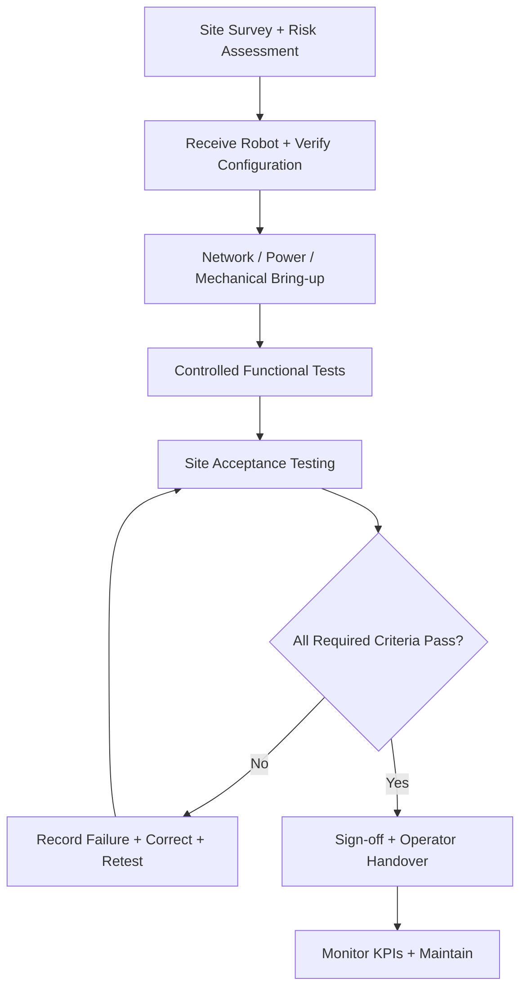
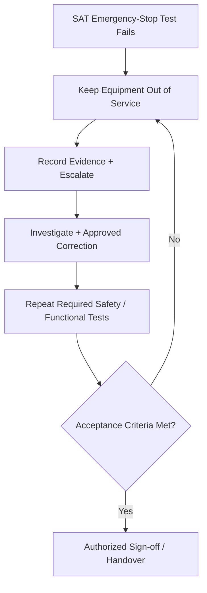
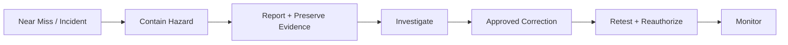
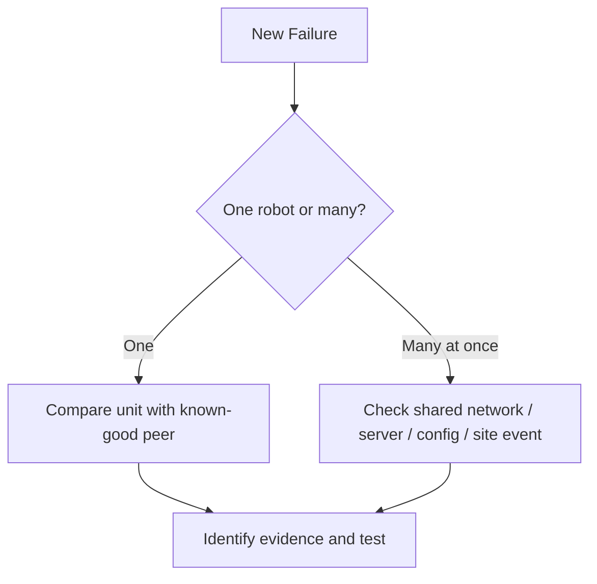

# Module 5: Deployment, Site Acceptance Testing, Safety, and Operations

> **Core idea:** A robot is not successfully deployed just because it moved once. Field success requires site readiness, safe commissioning, acceptance evidence, clear handover, and ongoing reliability.
>
> Examples are general field-engineering study cases, not an employer's official acceptance protocol.

## 1. Think of deployment as a lifecycle



The purpose of commissioning is to bring a system into an operable, correctly configured state. **Site Acceptance Testing (SAT)** then determines whether it meets the predefined acceptance requirements at the actual site. Passing commissioning does not automatically equal passing SAT.

## 2. Site assessment: inspect the real environment

| Area | What to establish | Why it matters |
|---|---|---|
| Robot/task | Intended task, payload, load path, capacity, expected cycle time | Prevents use outside approved operating conditions |
| Aisles/geometry | Width, turning radius, swept path, thresholds, ramps, overhead clearance | Avoids collisions and load interference |
| Floor | Surface, friction, transitions, grades | Impacts traction, stability, caster loads |
| Rack/load | Weight, center of gravity, caster condition, hitch/coupling integrity | Prevents stall, tip-over, runaway load |
| People/safety | Traffic separation, protective fields, E-stop access, site procedures | Limits exposure to hazardous motion |
| Infrastructure | Power, charging, network, permissions, environmental restrictions | Determines whether the robot can operate reliably |
| Software/config | Approved versions, robot identity, map, frames, credentials, timing | Prevents site mismatch and integration faults |
| Support | Operators, spare parts, vendors, training, incident ownership | Ensures responsible maintenance and response |

### Example: actual aisle is narrower than the simulation

A simulation pass does not prove a real loaded turn is safe. Check the full **swept envelope** of robot plus rack, obstacle clearance, and protective sensing. Escalate for route redesign or approved workflow change; do not shrink safety margins unofficially.

## 3. Commissioning versus SAT

### Commissioning

A typical high-level order is:

```text
Inspect and identify equipment
→ Establish approved power/network/configuration
→ Confirm safety state and interfaces
→ Bring up hardware/software in approved order
→ Run controlled functional checks
→ Capture logs and baseline versions
```

### Site Acceptance Testing (SAT)

SAT is evidence against **pre-agreed criteria**, not an impression that the system “looks fine.”

| SAT area | Representative evidence |
|---|---|
| Identity and configuration | Correct robot, approved versions, site settings |
| Safety function | Authorized E-stop/protective-stop tests, records and pass/fail |
| Basic motion | Controlled route, speed, stop behavior |
| Representative load | Authorized rack transport under site conditions |
| Navigation | Reliable route following, localization, obstacle handling |
| Turns and clearance | Loaded swept path and obstacle separation |
| Docking and charging | Physical engagement, charging state, recovery |
| Communications | Required fleet/network behavior and approved outage recovery |
| Restart and recovery | Safe state and authorized recovery procedure |
| Handover | Operator training, documentation, acceptance signatures |

**Illustrative rule:** A loaded tug that passes empty motion but fails loaded transport **has failed that acceptance criterion**. Document what failed and retest after an approved correction.

## 4. Failed emergency-stop test: the stop/go decision



A customer may be under operational pressure, but **deployment cannot be approved on an unresolved failed critical safety requirement**. Explain the observed failure, safety implications, remediation owner, and retest criteria. Suggest an approved alternative workflow if available. Never bypass a protection device or sign off a failed test.

**Technical distinction:** An emergency stop concerns reducing hazards from machine operation; it is **not inherently the same as disconnecting all electrical power**, and it does not by itself provide short-circuit protection.

## 5. Near misses and post-deployment safety incidents

**No injury does not mean no incident.** If a robot nearly contacts a person, take the event seriously even if the robot later appears normal.



### Correct response sequence

1. Stop/contain according to the site's emergency procedure; protect people and provide appropriate assistance.
2. Secure the area and equipment; do not restart merely because the fault disappeared.
3. Notify the designated site/safety leadership and preserve logs, telemetry, relevant time stamps, and witness accounts as policy permits.
4. Determine scope: one robot, one route, recent configuration change, or fleet-wide issue?
5. Investigate **direct causes and contributing conditions**, including sensors, commands, operating environment, training, and procedures.
6. Apply approved corrective measures and repeat required safety and functional verification.
7. Obtain authorization for return to service, document, and monitor for recurrence.

**Avoid:** masking alarms, clearing evidence before preserving it, unapproved “stress tests,” bypassing protective sensors, or allowing schedule pressure to override safety acceptance.

## 6. Operational metrics after handover

| KPI | Meaning | If it worsens, investigate... |
|---|---|---|
| **Availability** | Uptime / (uptime + downtime) under an agreed definition | Repeated faults, slow recovery, lack of parts |
| **Utilization** | Productive operating time relative to defined available time | Assignment, workflow, demand, downtime |
| **MTTR** | Mean time to repair/restore | Troubleshooting delay, escalation, spare parts |
| **MTBF** | Mean operating time between failures, using a consistent definition | Reliability, wear, environment, recurring faults |
| **Throughput** | Completed tasks per unit time | Queueing, route delays, availability |
| **Cycle time** | Time needed per completed task | Stops, docking, congestion, load handling |
| **Safety incidents** | Incident and near-miss count/severity | Recurring hazards and risk controls |
| **Maintenance cost** | Agreed sum of parts/labor/related costs | Recurring part faults and repair inefficiency |

### Example: cycle time regresses after SAT

SAT baseline: **8 minutes per cycle**. Current measured average: **14 minutes**.

Don't immediately increase speed. Split the cycle into waiting, loading/unloading, route traversal, protective stops, localization, queueing, and docking. Compare logs and environmental changes, then correct the real bottleneck within approved safety limits.

## 7. One robot fails versus five robots fail



Several robots failing simultaneously after a software update may indicate a shared upstream problem. One robot failing while peers operate may favor a unit-specific mechanical, power, configuration, or sensor issue. Neither pattern proves root cause without evidence.

## 8. Communicating with operators and stakeholders

A clear field update includes:

1. **Safety/status:** Is the robot operating, isolated, or out of service?
2. **Observed facts:** What has been verified, and what remains uncertain?
3. **Operational impact:** Which tasks, loads, routes, or robots are affected?
4. **Next evidence/action:** Who is responsible and what is the next diagnostic step?
5. **Return-to-service gate:** What must be tested and approved before operation resumes?

**Good phrasing:**

> “The robot is safely out of service. We've confirmed the loaded-motion failure, but the root cause is not yet established. We're reviewing drive status and mechanical loading with the appropriate team. We'll repeat the required loaded and safety checks before requesting approval to resume operation.”

Do not promise an unsupported recovery time or assign blame before investigation.

## 9. What goes into a field record?

Record site/unit identifier, date and time, software/configuration baseline, symptom, actual versus expected behavior, fault codes/log references, tests and results, confirmed cause or unresolved status, corrective action, responsible person, retest evidence, safety authorization, and sign-off.

## Notebook summary

```text
Site Survey → Commission → SAT → Sign-off → Handover → Monitor
SAT fail → Document → Correct → Retest → Authorization
Near Miss → Contain → Report → Investigate → Correct → Retest
KPIs: Availability, Utilization, MTTR, MTBF, Throughput, Cycle Time
Safety approval is a GO / NO-GO gate, not a negotiation.
```

### Self-check

- Why isn't a single successful navigation run enough to pass SAT?
- What do you do if the E-stop fails and the customer requests immediate deployment?
- What is your first action following a near miss?
- If throughput declines, what evidence do you seek before changing speed?

[← Previous: Linux, ROS 2, and Sensors](04-Linux-ROS2-Sensors.md) · [← README](README.md)

---