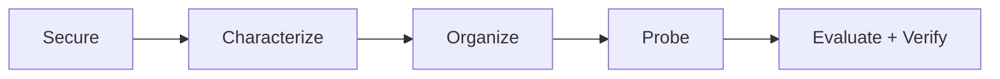

# **Robotics Field Engineering**

## **(A Five-Module Study Notes)**

A concise, flowchart-first set of technical notes covering practical robotics troubleshooting, mechanical systems, electrical hardware, Linux/ROS 2, and field deployment.

The emphasis is **system boundaries, competing hypotheses, discriminating evidence, and safe verification**, rather than memorizing isolated definitions.

## Start here

| Module | Notes | What you'll learn |
|---|---|---|
| **01** | [Thinking Like a Field Troubleshooter](01-Field-Troubleshooting.md) | SCOPE, command-to-motion chain, symptom characterization, safety, and fault isolation |
| **02** | [Mechanical Intuition, Drivetrains, and Tugs](02-Mechanical-Systems.md) | Torque, friction, traction, gears, wheel slip, load, and basic tools |
| **03** | [Electrical Hardware, Drives, and Feedback](03-Electrical-Systems.md) | Power paths, voltage sag, motor drives, overtemperature, encoders, and PID basics |
| **04** | [Linux, Networking, ROS 2, and Sensors](04-Linux-ROS2-Sensors.md) | Linux troubleshooting, systemd/journals, network layers, ROS topics, and sensor diagnostics |
| **05** | [Deployment, SAT, Safety, and Operations](05-Deployment-SAT-Safety.md) | Site survey, commissioning, acceptance tests, incident response, KPIs, and handover |

## The unifying diagnostic method: SCOPE



1. **Secure** people, the robot, and the environment.
2. **Characterize** expected versus actual behavior.
3. **Organize** the system into diagnostic boundaries.
4. **Probe** competing hypotheses with approved, high-information tests.
5. **Evaluate** the evidence, perform authorized corrective work, verify, and document.

A strong diagnosis sounds like:

> “My two leading hypotheses are **A** and **B**. I would check **X**. If the result is **Y**, it supports A; if **Z**, it supports B. After correcting the confirmed cause, I'd verify safe functionality and document the outcome.”

## How to study

- Read modules **01 → 05** in order. Their concepts build from system-level troubleshooting to field operations.
- Redraw the Mermaid fault trees from memory.
- For each worked scenario, identify **two hypotheses**, **one discriminating observation**, and **the safe return-to-service condition**.
- Use the **Notebook summary** and **Self-check** at the bottom of each module for rapid revision.

## Repository contents

```text
Robotics-Field-Engineering-Notes/
├── README.md
├── 01-Field-Troubleshooting.md
├── 02-Mechanical-Systems.md
├── 03-Electrical-Systems.md
├── 04-Linux-ROS2-Sensors.md
└── 05-Deployment-SAT-Safety.md
```

## Scope, provenance, and safety

These study notes are adapted from the first five modules of the accompanying **Round 4 Field Hardware Interview Preparation Manual** and the flowchart-first teaching/revision session. They consolidate general mechanical, electrical, ROS 2, Linux, and commissioning principles and use **illustrative robotic-tug scenarios**.

- They are **not** an equipment manufacturer's maintenance manual, a company-specific operating procedure, or a claim about a particular production robot's architecture.
- Example voltage levels, payloads, fault patterns, topic names, and acceptance tests are **not verified product specifications**.
- Safety-critical operation, energy isolation, electrical testing, repair, and return-to-service must follow actual site rules, manufacturer procedures, qualifications, and authorization.
- These files intentionally contain **only Modules 1–5**. Mock interviews, scenario gauntlets, private recruiting details, and project case studies are outside this set.

## Reading the diagrams on GitHub

GitHub renders fenced `mermaid` flowcharts directly in supported Markdown views. Mathematical notation is written in Markdown-compatible LaTeX.

**Core principle:** *Measure the boundary where commanded or expected behavior stops matching what the physical robot actually does.*

---